<div align="center">

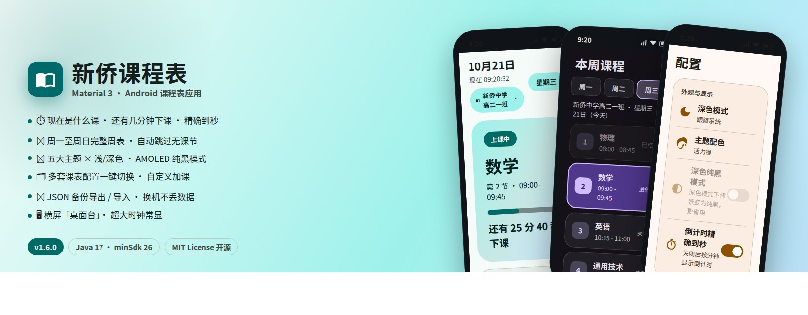

# 📚 新侨课程表 · ClassScheduleApp

**Material 3 风格的 Android 课程表应用 —— 实时倒计时 · 多套配置 · 五大主题 · 备份恢复**

<p>
  
  
  
  
  
</p>

</div>

---

## ✨ 功能特性

| 模块 | 能力 |
| --- | --- |
| ⏱ **概括页** | 现在是什么课（课程名 / 节次 / 时间段 / 进度条）、还有几分钟下课（可精确到秒）、下一节课与倒计时（自动跳过“无”课节）、距离放学、周末倒计时（休息日变返校倒计时）、今日课程进度，每秒自动刷新 |
| 📅 **课表页** | 周一至周日七天切换，默认选中当天；当前正在上的课主题色高亮 +「进行中」，已结束 / 未开始分别标注，自动滚动定位；无课日显示空提示 |
| ⚙️ **配置页** | 深色模式（跟随系统 / 浅色 / 深色）、五大主题配色、AMOLED 深色纯黑模式、倒计时精确到秒；内置两套只读默认课表；自定义配置可空白新建 / 一键复制，支持逐节改名、加课（第 13、14 节……）、改时间、删除 |
| 💾 **备份恢复** | 自定义配置一键导出 JSON / 从文件导入恢复，换机重装不丢数据；导入前校验格式，损坏数据自动跳过 |
| 🖥 **横屏桌面台** | 横屏自动进入全屏桌面台：超大时钟、当前课程与进度、各类倒计时一屏尽览，光斑漂移背景，任意分辨率自适应缩放不裁切 |

## 📱 应用截图

<div align="center">

<table>
  <tr>
    <td>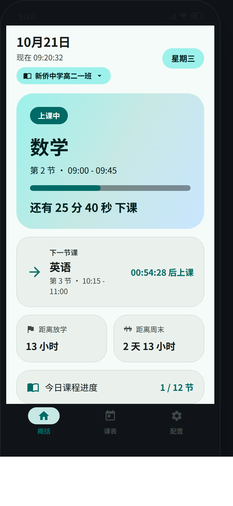</td>
    <td>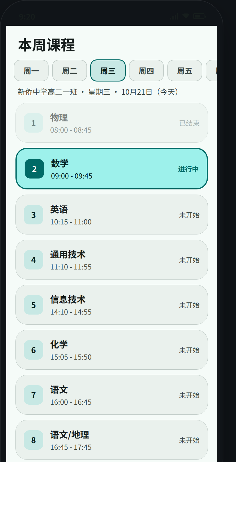</td>
    <td>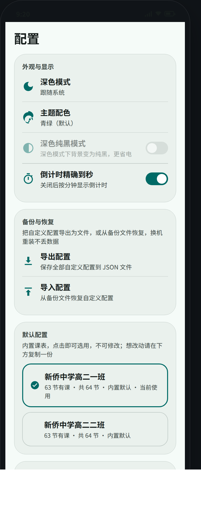</td>
  </tr>
  <tr>
    <td align="center"><b>概括页</b> · 青绿（浅色）</td>
    <td align="center"><b>课表页</b> · 青绿（浅色）</td>
    <td align="center"><b>配置页</b> · 青绿（浅色）</td>
  </tr>
  <tr>
    <td>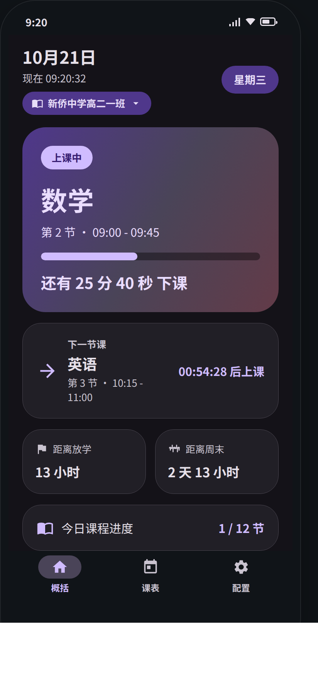</td>
    <td>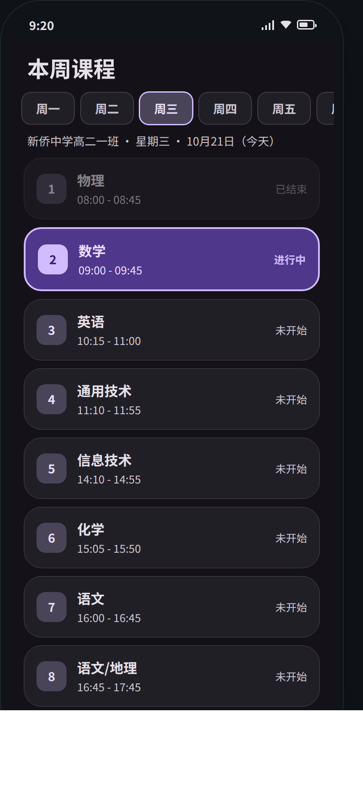</td>
    <td>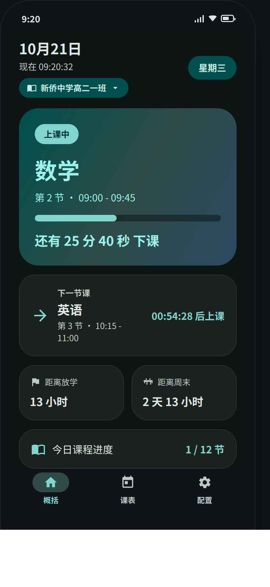</td>
  </tr>
  <tr>
    <td align="center"><b>概括页</b> · 紫罗兰（深色）</td>
    <td align="center"><b>课表页</b> · 紫罗兰（深色）</td>
    <td align="center"><b>概括页</b> · 青绿（深色）</td>
  </tr>
  <tr>
    <td>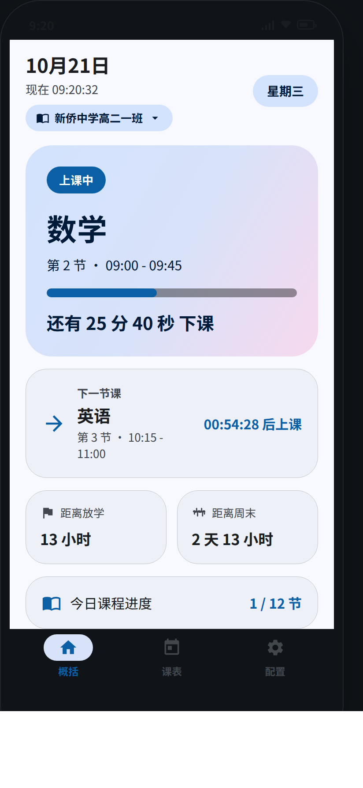</td>
    <td>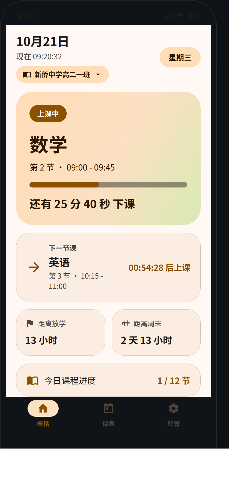</td>
    <td>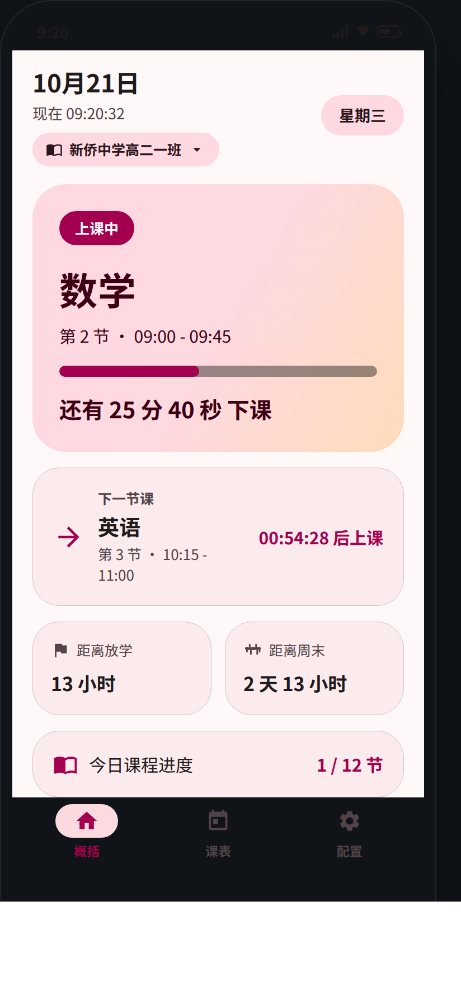</td>
    <td>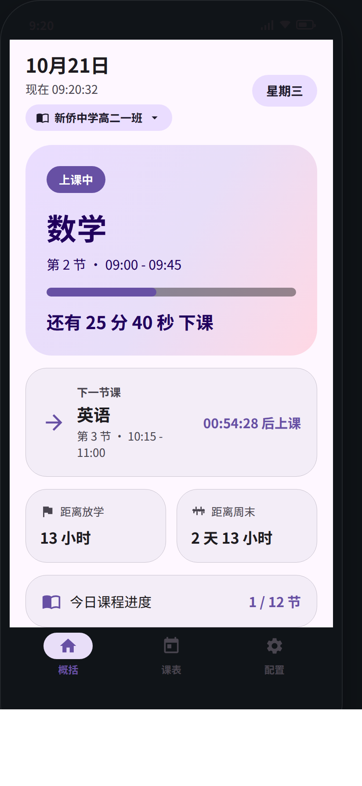</td>
  </tr>
  <tr>
    <td align="center"><b>概括页</b> · 海洋蓝（浅色）</td>
    <td align="center"><b>概括页</b> · 活力橙（浅色）</td>
    <td align="center"><b>概括页</b> · 樱花粉（浅色）</td>
    <td align="center"><b>概括页</b> · 紫罗兰（浅色）</td>
  </tr>
</table>

</div>

## 🎨 五大主题配色

青绿（默认）/ 海洋蓝 / 紫罗兰 / 活力橙 / 樱花粉，浅色与深色均有完整适配，深色模式下还可开启 AMOLED 纯黑背景。

<div align="center">

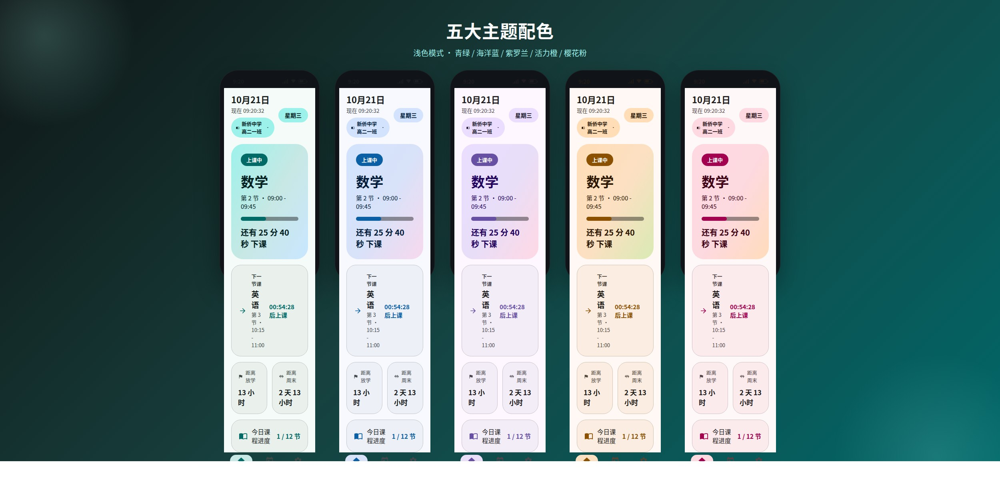

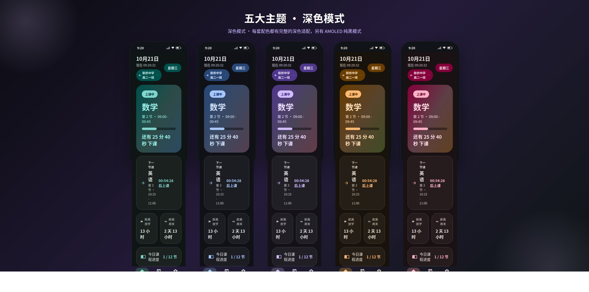

</div>

## 🖥 横屏「桌面台」

<div align="center">

<table>
  <tr>
    <td>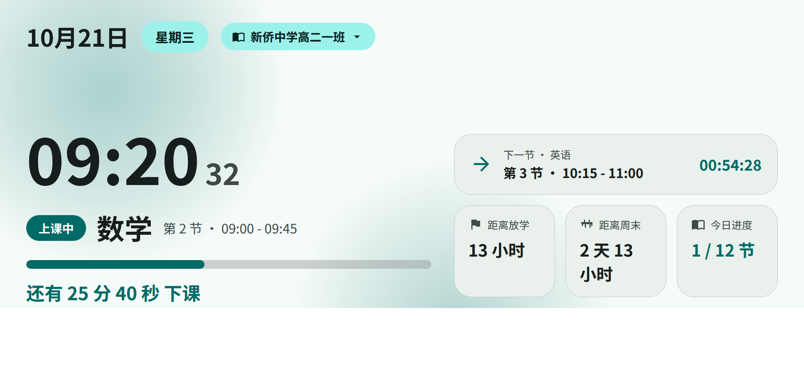</td>
    <td>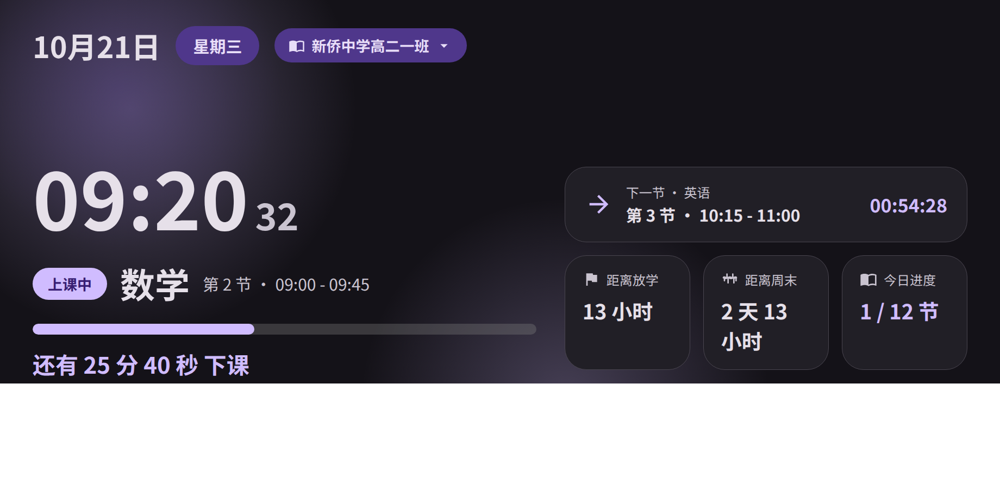</td>
  </tr>
  <tr>
    <td align="center">浅色</td>
    <td align="center">深色</td>
  </tr>
</table>

</div>

## 🎁 项目海报

<div align="center">

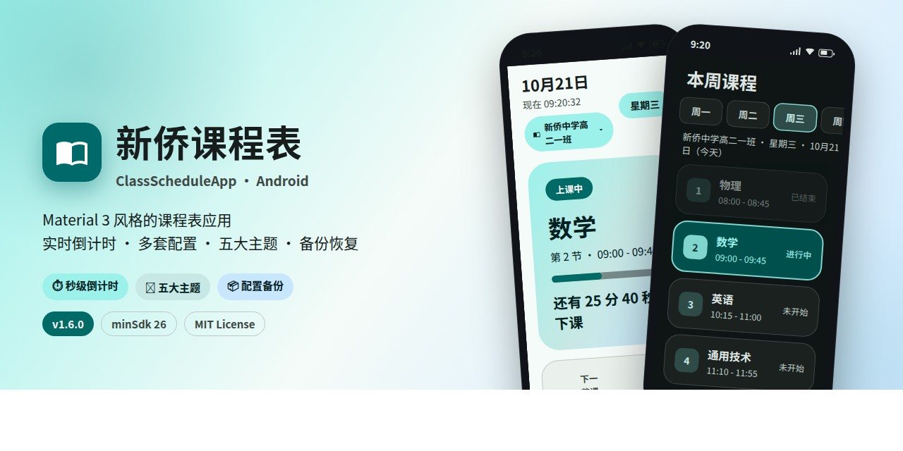
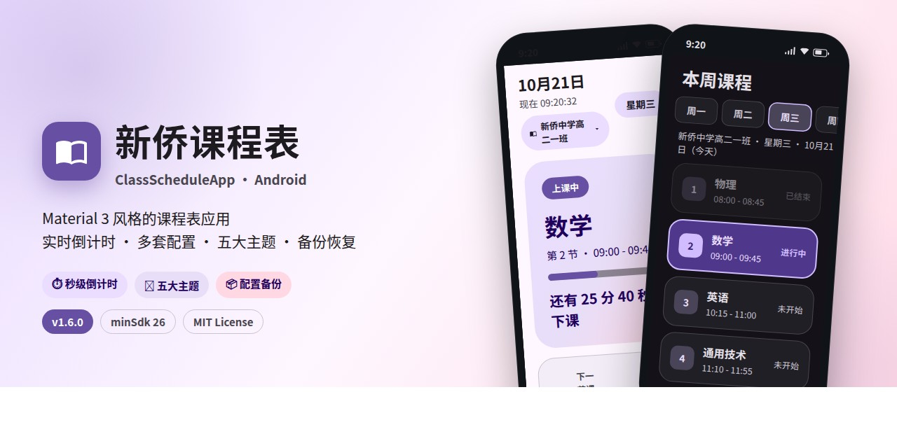

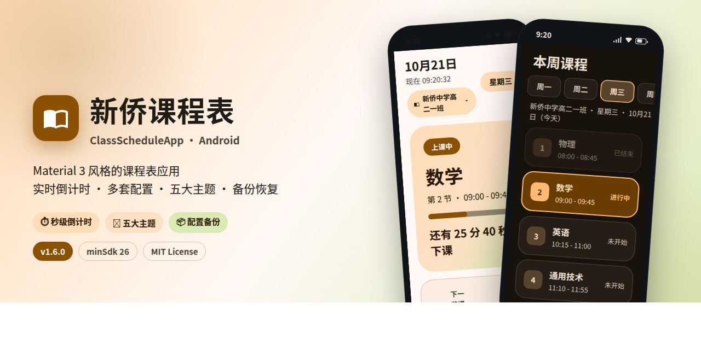
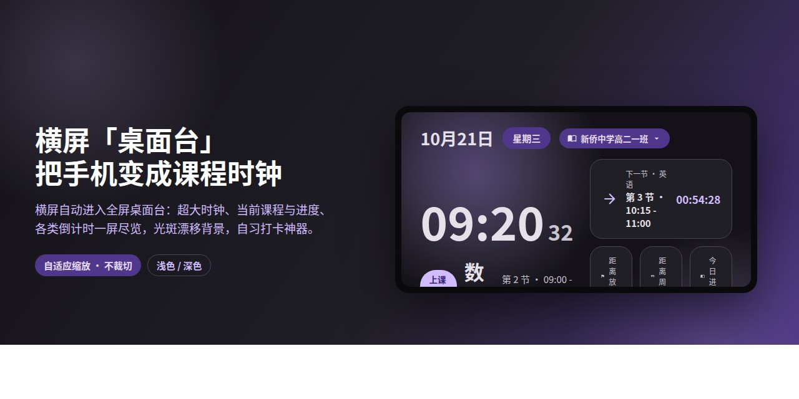

</div>

---

## 🛠 技术栈

- **语言**：Java 17，minSdk 26（Android 8.0），targetSdk / compileSdk 34
- **UI**：Material Components 1.12（Material 3 / Material You）、AndroidX Fragment / RecyclerView / ViewBinding
- **架构**：单 Activity + Fragment（概括 / 课表 / 配置 / 课程编辑器）+ BottomNavigationView
- **时间**：`java.time` 时间计算；数据持久化 SharedPreferences + JSON 序列化

## 📐 目录结构

```
app/src/main/java/com/classschedule/
├── MainActivity.java            # 宿主 Activity + 底部导航 + 编辑器跳转 + 主题重建交叉淡入
├── data/
│   ├── PeriodItem.java          # 单节数据（名称/起止时间/是否自定义/时间合法性校验）
│   ├── DayPlan.java             # 一天的节次列表（节数可变，反序列化过滤损坏项）
│   ├── CoursePeriod.java        # 运行时一节课
│   ├── DaySchedule.java         # 一天课表（空安全/首末节查找）
│   ├── WeekTable.java           # 由配置构建的一周课表（7 天，非法节次双保险跳过）
│   ├── ScheduleProfile.java     # 一套课程表配置（JSON 序列化 + 旧版迁移）
│   ├── SettingsStore.java       # 多配置与设置的持久化中心（单例）+ 备份导出/导入
│   ├── ScheduleRepository.java  # 默认时间段与内置课程表数据（一班/二班）
│   └── TimeFmt.java             # 中文时间格式化
├── engine/
│   ├── ScheduleEngine.java      # 当前课/下节课/倒计时推导
│   └── ScheduleStatus.java      # 状态快照
└── ui/
    ├── OverviewFragment.java    # 概括页（竖屏卡片 / 横屏桌面台）
    ├── ScheduleFragment.java    # 课表页
    ├── SettingsFragment.java    # 配置页（外观/备份恢复/配置管理）
    ├── ProfileEditFragment.java # 课程编辑器（改名/加课/改时间/删除）
    ├── PeriodAdapter.java       # 课表列表适配器
    └── ThemeHelper.java         # 配色方案与主题样式映射
```

## 🔨 构建

```bash
# 需要 JDK 17 与 Android SDK（platform 34 / build-tools 34.0.0）
./gradlew assembleRelease     # 产物：app/build/outputs/apk/release/app-release.apk
./gradlew assembleDebug       # 调试包
```

### 签名说明

release 使用 `app/release.keystore`（仅用于侧载安装，未随仓库分发）：

- alias：`classschedule`
- 密钥库/密钥口令：`classschedule2026`

正式发布请替换为自己的密钥库并修改 `app/build.gradle` 的 `signingConfigs.release`。

## 📥 安装

将 `app-release.apk` 传到安卓手机，允许「安装未知来源应用」后点击安装即可。

## 🗺 版本记录

- **1.6.0**（versionCode 16）
  - 新增「备份与恢复」：自定义配置导出为 JSON 文件 / 从文件导入恢复（SAF 文档选择器，无需存储权限）
  - 数据健壮性加固：损坏的单条配置不再导致全部配置丢失；非法时间的节次自动跳过，不再崩溃
  - 周末倒计时泛化：周六/周日有课的配置也能按「本周最后一个有课日放学」正确计算
  - 「关于」卡片版本号改为动态读取 `BuildConfig.VERSION_NAME`，升级不再漏改
- **1.5.0**（versionCode 15）：内置两套默认课表（高二一班/二班）、周日 4 节晚自习、旧版数据自动迁移

## 📄 开源协议

本项目基于 **MIT License** 开源 —— 允许自由使用、复制、修改、合并、发布、分发、再授权及销售，唯一要求是在副本中保留版权声明与许可声明。详见 [LICENSE](LICENSE)。

---

<div align="center">

**如果这个项目对你有帮助，欢迎点个 ⭐ Star 支持一下！**

</div>
